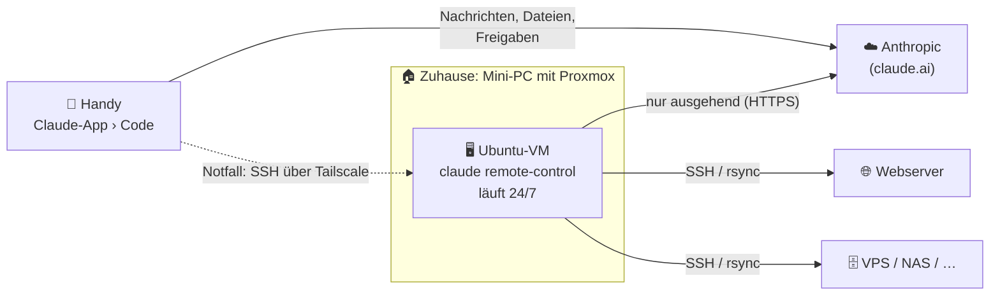

# 🤖 Claude Code auf dem Mini-PC – gesteuert vom Handy

Ein eigener kleiner Rechner zu Hause, auf dem **Claude Code rund um die Uhr
läuft** und den du **von unterwegs mit der Claude-App steuerst**: „Lade die
Datei hoch“, „Aktualisiere alle Server“, „Deploy die Website“ – Claude
erledigt das per SSH auf deinen Servern und meldet sich per Push-Nachricht.

Dieses Kit richtet alles mit einem Skript ein: Claude Code, Dauerbetrieb mit
Neustart nach Abstürzen, eigener SSH-Schlüssel, Server-Verwaltung,
Sicherheitsregeln und automatische Updates.

## So funktioniert's



- **[Remote Control](https://code.claude.com/docs/en/remote-control)**: Claude
  Code läuft auf dem Mini-PC, die Claude-App ist nur das Fenster dorthin. Der
  Mini-PC baut die Verbindung selbst auf – **am Router wird nichts
  freigegeben**.
- **Dauerbetrieb**: Ein systemd-Dienst hält `claude remote-control` am Laufen
  und startet es nach Absturz, Stromausfall oder Internet-Ausfall neu.
- **Eigener Benutzer und Schlüssel**: Claude arbeitet als Benutzer `claude`
  ohne Admin-Rechte und meldet sich mit einem eigenen SSH-Schlüssel an deinen
  Servern an.
- **Sicherheitsnetz**: Im Auto-Modus prüft ein zweites Modell jede Aktion,
  feste Regeln sperren Gefährliches, und Proxmox-Snapshots machen jede Panne
  rückgängig.

## Was du brauchst

| | |
|---|---|
| **Mini-PC** | z. B. Intel N100/N150 mit 16 GB RAM und SSD, [Proxmox VE](https://www.proxmox.com/de/proxmox-virtual-environment) installiert. Braucht im Leerlauf ~6–10 W. |
| **Claude-Abo** | Pro oder Max. Remote Control funktioniert nur mit claude.ai-Anmeldung, nicht mit API-Key, und nutzt dein normales Nutzungskontingent. |
| **Handy** | Claude-App ([iOS](https://apps.apple.com/us/app/claude-by-anthropic/id6473753684), [Android](https://play.google.com/store/apps/details?id=com.anthropic.claude)), mit demselben Konto angemeldet |
| **Optional** | [Tailscale](https://tailscale.com) und ein SSH-Client wie [Termius](https://termius.com) für den Notfall-Zugang vom Handy |

## Einrichtung

### 1. VM in Proxmox anlegen

**Warum eine VM?** Mit Snapshots und Backups ist jeder Fehler in einer Minute
rückgängig gemacht – deshalb darf Claude in seiner VM wirklich viel. Und der
Mini-PC bleibt frei für weitere Dienste.

Neue VM mit dem ISO von **Ubuntu Server 24.04 LTS**:

| Einstellung | Wert |
|---|---|
| CPU | 2 Kerne, Typ `host` |
| Arbeitsspeicher | 4 GB (8 GB, wenn Claude auch Projekte bauen soll, z. B. `npm run build`) |
| Festplatte | 40 GB, „SSD emulation“ und „Discard“ an |
| Netzwerk | `vmbr0` (Bridge ins Heimnetz) |
| Optionen | **Start at boot: Ja** · **QEMU Guest Agent: an** |

Im Ubuntu-Installer: einen Hostnamen wie `minipc` wählen (so heißen später die
Sessions in der App), deinen Admin-Benutzer anlegen und **„Install OpenSSH
server“** ankreuzen.

Danach in Proxmox:

- **Backup**: *Rechenzentrum → Backup → Hinzufügen*: täglich, Modus
  „Snapshot“, 7 Stück aufbewahren.
- **Vor Experimenten**: *VM → Snapshots → Snapshot erstellen*. Geht etwas
  schief: Snapshot auswählen → *Rollback*.
- **BIOS des Mini-PCs**: „Restore on AC Power Loss“ auf **Power On** stellen,
  damit er nach einem Stromausfall von selbst wieder hochfährt.

> Ohne Proxmox geht es genauso: Ubuntu Server 24.04 oder Debian 12/13 direkt
> auf den Mini-PC (oder einen Raspberry Pi 5) installieren und bei Schritt 2
> weitermachen.

### 2. SSH-Schlüssel vom PC hinterlegen

Damit du dich ohne Passwort anmeldest – das Setup schaltet den Passwort-Login
danach ab (aber nur, wenn ein Schlüssel hinterlegt ist).

Unter **Windows** (PowerShell):

```powershell
ssh-keygen -t ed25519    # nur, falls du noch keinen Schlüssel hast
type $env:USERPROFILE\.ssh\id_ed25519.pub | ssh rene@minipc "mkdir -p ~/.ssh && cat >> ~/.ssh/authorized_keys"
```

Unter Linux/macOS: `ssh-copy-id rene@minipc`

Willst du auch vom Handy per SSH (Termius) auf die VM, hinterlege dessen
Schlüssel jetzt ebenfalls in `~/.ssh/authorized_keys`.

### 3. Setup-Skript ausführen

```bash
ssh rene@minipc
sudo apt install -y git
git clone https://github.com/renezmn/renezmn.git
cd renezmn/claude-mini-pc
sudo ./setup.sh --owner René --github renezmn --tailscale
```

Das Skript (dauert ein paar Minuten):

1. bringt das System auf den neuesten Stand und installiert Werkzeuge
   (git, rsync, tmux, jq …); in einer Proxmox-VM auch den QEMU-Gast-Agenten
2. schaltet **automatische Sicherheitsupdates** ein (Neustart bei Bedarf um 04:30)
3. schaltet Standby und Ruhezustand ab
4. legt den Benutzer `claude` an – ohne Passwort und ohne Admin-Rechte
5. installiert **Claude Code** (aktualisiert sich danach selbst)
6. legt den Arbeitsordner `~claude/workspace` mit [`CLAUDE.md`](workspace/CLAUDE.md)
   (Claudes Arbeitsanweisungen) und [`SERVERS.md`](workspace/SERVERS.md) an
7. erzeugt Claudes SSH-Schlüssel
8. richtet den **Auto-Modus** mit Sicherheitsregeln ein ([`config/settings.json`](config/settings.json))
9. installiert den Dienst `claude-remote` und den Befehl `claude-rc`
10. aktiviert die Firewall (eingehend nur SSH) und härtet den SSH-Zugang

| Option | Bedeutung |
|---|---|
| `--owner NAME` | Dein Vorname für Claudes Arbeitsanweisungen |
| `--github BENUTZER` | Dein GitHub-Konto – Pushes in deine Repos gelten als vertrauenswürdig |
| `--tailscale` | Tailscale installieren (SSH-Notfallzugang von unterwegs) |
| `--sudo` | Claude darf in der VM Admin-Befehle ohne Passwort ausführen. Mit Proxmox-Snapshots vertretbar, ohne VM nicht empfohlen. |
| `--user NAME` | Anderer Linux-Benutzer für Claude (Standard: `claude`) |
| `--channel latest` | Neueste statt stabiler Claude-Code-Versionen |
| `--no-firewall`, `--no-ssh-hardening`, `--no-auto-reboot` | Den jeweiligen Schritt weglassen |
| `--uninstall` | Dienst und Befehle entfernen (Benutzer und Daten bleiben) |

Das Skript kann jederzeit erneut laufen – deine Anpassungen bleiben erhalten.

### 4. Anmelden und Remote Control einschalten

Am Ende fragt das Setup, ob es weitergehen soll – oder später:

```bash
claude-rc first-run
```

1. **Anmelden**: Claude startet. „Claude account with subscription“ wählen,
   den angezeigten Link am Handy oder PC öffnen, anmelden, Code einfügen.
   Die Frage „Do you trust the files in this folder?“ mit **Yes** beantworten.
   Tipp: `/config` öffnen und **„Push when Claude decides“** sowie
   **„Push when actions required“** einschalten. Mit `/exit` beenden.
2. **Remote Control freischalten**: `Enable Remote Control? (y/n)` mit `y`
   beantworten. Mit der **Leertaste** erscheint ein QR-Code – mit dem Handy
   scannen und eine Test-Nachricht schicken. Dann `Strg+C`.
3. **Dauerbetrieb**: Der Dienst startet und läuft ab jetzt nach jedem Neustart
   von selbst.

### 5. Handy einrichten

- In der Claude-App auf **Code** tippen: Der Mini-PC erscheint als Session
  `minipc-…` mit **grünem Punkt**. Antippen und loslegen.
- Mitteilungen für die Claude-App erlauben (Android: Akku-Optimierung für die
  App abschalten), sonst kommen keine Push-Nachrichten.
- **Wichtig für die Sicherheit**: Wer dein Claude-Konto hat, steuert damit den
  Mini-PC – und deine Server. Sichere die Anmeldung mit Zwei-Faktor und
  schalte in [claude.ai](https://claude.ai/settings/account) unter *Einstellungen → Konto*
  **„Require trusted devices“** ein. Dann funktioniert Remote Control nur auf
  Geräten, die du freigegeben hast (Bestätigung per Face ID/Fingerabdruck).

### 6. Server eintragen

**Auf jedem Zielserver** (einmalig) einen eigenen Benutzer für Claude anlegen
und Claudes Schlüssel eintragen. Den Schlüssel zeigt `claude-rc pubkey` an.

```bash
sudo useradd -m -s /bin/bash deploy
sudo install -d -m 700 -o deploy -g deploy /home/deploy/.ssh
echo "ssh-ed25519 AAAA… claude@minipc" | sudo tee -a /home/deploy/.ssh/authorized_keys
sudo chown deploy:deploy /home/deploy/.ssh/authorized_keys
sudo chmod 600 /home/deploy/.ssh/authorized_keys
# Schreibrechte dort, wo Claude hochladen soll, z. B.:
sudo chown -R deploy:www-data /var/www/meine-seite
```

Soll Claude auch Updates einspielen oder Dienste neu starten, erlaubst du genau
diese Befehle ohne Passwort:

```bash
echo 'deploy ALL=(root) NOPASSWD: /usr/bin/apt-get update, /usr/bin/apt-get -y upgrade, /usr/bin/systemctl reload nginx' |
  sudo tee /etc/sudoers.d/deploy
sudo chmod 440 /etc/sudoers.d/deploy && sudo visudo -cf /etc/sudoers.d/deploy
```

**Auf dem Mini-PC** den Server eintragen:

```bash
claude-rc add-server web deploy@203.0.113.10 --desc "Webserver (nginx, statische Seiten)"
```

Das legt den SSH-Alias `web` an, testet die Verbindung (und bietet sonst an,
den Schlüssel per `ssh-copy-id` zu übertragen), trägt den Server in
`SERVERS.md` ein und markiert ihn für den Auto-Modus als deinen eigenen
Server. `claude-rc servers` zeigt alle Server mit Verbindungsstatus.

> Webspace nur mit SFTP? Geht auch – Claude nutzt dann `scp`/`sftp` statt
> `rsync`. Der Verbindungstest zeigt dort ✘, weil keine Shell erlaubt ist.

## Im Alltag

Einfach in der App schreiben, zum Beispiel:

- „Lade die Datei, die ich dir gerade geschickt habe, nach `web:/var/www/downloads/` hoch.“
  *(Dateien und Fotos aus der App landen direkt auf dem Mini-PC.)*
- „Aktualisiere alle Server und sag mir, ob einer neu starten muss.“
- „Zieh das neueste `main` von meiner Website, bau sie und deploy sie auf `web`.“
- „Wie voll sind die Festplatten auf allen Servern?“
- „Prüfe jede Stunde, ob https://example.de erreichbar ist, und schick mir eine Push-Nachricht, wenn nicht.“
  *(Solche Wiederholungen laufen nur in der offenen Session und höchstens 7 Tage.
  Für Dauerhaftes lass Claude lieber einen Cronjob auf dem Server einrichten.)*

Fragt Claude um Erlaubnis, bekommst du eine Push-Nachricht und bestätigst in
der App. Was genau passiert ist, steht im Verlauf der Session und in
`~/workspace/logs/`.

### Befehle auf dem Mini-PC

| Befehl | Wofür |
|---|---|
| `claude-rc status` | Läuft alles? Version, Anmeldung, letzte Protokollzeilen |
| `claude-rc attach` | Claudes Terminal ansehen (QR-Code, Fehlermeldungen). Raus mit `Strg+b`, dann `d` |
| `claude-rc logs [-f]` | Protokoll der Dauerschleife (mit `-f` live) |
| `claude-rc restart` | Neu starten – offene Sessions werden fortgesetzt |
| `claude-rc servers` | Server auflisten und Verbindung testen |
| `claude-rc add-server` / `remove-server` | Server ein- und austragen |
| `claude-rc pubkey` | Claudes öffentlichen SSH-Schlüssel anzeigen |
| `claude-rc login` | Claude-Anmeldung erneuern |
| `claude-rc doctor` | Diagnose, z. B. warum Remote Control nicht startet |
| `claude-rc update` | Claude Code sofort aktualisieren |
| `claude-rc shell` | Shell als Benutzer `claude` im Arbeitsordner |

## Sicherheit

| Schicht | Schutz |
|---|---|
| **Netzwerk** | Remote Control baut nur ausgehende Verbindungen auf. Die Firewall lässt eingehend nur SSH durch – und am Router ist nichts freigegeben. |
| **Konto** | Zwei-Faktor-Anmeldung und „Require trusted devices“ (siehe Schritt 5) |
| **Rechte** | Claude läuft als eigener Benutzer ohne Admin-Rechte (außer mit `--sudo`) und kommt nur an die Server, für die du ihm einen Schlüssel gibst. |
| **Auto-Modus** | Ein Prüfmodell sieht jede Aktion vorab und blockt z. B. `curl … \| bash`, Force-Push, Massenlöschungen und das Weitergeben von Geheimnissen. Unklare Fälle landen als Frage auf deinem Handy. |
| **Feste Regeln** | [`settings.json`](config/settings.json): Claude darf seine privaten Schlüssel und seine Anmeldung nicht lesen und seine eigenen Regeln nicht ändern. Force-Push, Neustart und Firewall-Änderungen fragen immer nach. |
| **Arbeitsanweisungen** | [`CLAUDE.md`](workspace/CLAUDE.md): erst prüfen, Probelauf bei Uploads, vorher sichern, nachfragen vor Löschen und Neustarts, alles protokollieren |
| **Server** | eigener `deploy`-Benutzer mit minimalen Rechten. Zugang entziehen = eine Zeile in `authorized_keys` löschen. |
| **Rückgängig** | Proxmox-Snapshots und tägliche Backups |

**Notbremse:** in der App die Session stoppen · `claude-rc stop` · im Notfall
die VM in Proxmox anhalten (mit Tailscale auf dem Proxmox-Host geht das auch
vom Handy unter `https://<proxmox>:8006`).

Gut zu wissen: Solange Remote Control verbunden ist, speichert Anthropic den
Verlauf (Nachrichten, Antworten, ausgeführte Befehle), damit er auf allen
Geräten synchron ist. Dateien und Befehle bleiben auf dem Mini-PC.

## Aktuell halten

| Was | Wie |
|---|---|
| Betriebssystem | Sicherheitsupdates täglich automatisch, bei Bedarf Neustart um 04:30 |
| Claude Code | aktualisiert sich selbst (Kanal „stable“), aktiv nach dem wöchentlichen Neustart des Dienstes (sonntags ~05:00) – sofort mit `claude-rc update` |
| Dieses Kit | `cd ~/renezmn && git pull && sudo ./claude-mini-pc/setup.sh`, danach `claude-rc restart` |
| Deine Server | per Claude: „Aktualisiere alle Server“ |

## Anpassen

- **`/etc/claude-rc.env`**: Rechte-Modus (`auto`, `acceptEdits`, `default`),
  Session-Modus (`same-dir` oder `worktree` für parallele Aufgaben),
  Namenspräfix, weitere Optionen. Danach `claude-rc restart`.
- **`~claude/.claude/settings.json`**: Regeln und vertrauenswürdige Ziele für
  den Auto-Modus. Hinweise dazu:
  [Rechte](https://code.claude.com/docs/en/permissions) und
  [Auto-Modus](https://code.claude.com/docs/en/auto-mode-config). Prüfen mit
  `claude-rc shell` → `claude auto-mode config`.
- **`~claude/workspace/CLAUDE.md`**: Claudes Arbeitsanweisungen – ergänze
  eigene Abläufe („So deploye ich meine Website“). Das kann Claude auch
  selbst, wenn du es darum bittest.

## Fehlerbehebung

| Problem | Lösung |
|---|---|
| Mini-PC erscheint nicht in der App | `claude-rc status` und `claude-rc logs`. Ist die App mit demselben Konto angemeldet? In der App auf „Code“ tippen. |
| „You must be logged in …“ oder „requires a full-scope login token“ | `claude-rc login`. Nicht `claude setup-token` benutzen – solche Tokens reichen für Remote Control nicht. |
| „Remote Control isn't enabled for this account“ | `claude-rc doctor` zeigt die Ursache. Oft hilft `claude-rc shell` → `claude auth logout` → `claude auth login`. |
| „Workspace not trusted“ | `claude-rc first-run` erneut ausführen und dem Ordner vertrauen. |
| Offline nach Internet-Ausfall | Startet von selbst neu: Claude gibt nach ~10 Minuten ohne Netz auf, der Dienst startet es neu, sobald das Internet wieder da ist. |
| Session hängt | In der App eine neue Session starten oder `claude-rc restart`. |
| Auto-Modus blockiert einen Upload | Konkret sagen, was und wohin („Lade `dist/` per rsync nach `web:/var/www/site/`“). Ist der Server mit `claude-rc add-server` eingetragen? |
| `Permission denied (publickey)` | Claudes Schlüssel (`claude-rc pubkey`) fehlt auf dem Server in `authorized_keys`. |
| Keine Push-Nachrichten | Claude-App einmal öffnen, `/config` prüfen (Schritt 4), Mitteilungen erlauben, Android: Akku-Optimierung aus. |

## Warum Linux-VM und nicht Windows mit Claude Desktop?

Für SSH, Uploads und Server-Pflege ist Linux das natürliche Zuhause: `ssh` und
`rsync` sind eingebaut, Claude Code läuft ohne Bildschirm rund um die Uhr und
erscheint in der App genauso. Die Claude-Desktop-App braucht dagegen einen
angemeldeten, offenen Windows-Desktop und ist nicht für den Betrieb ohne
Bildschirm gedacht. Windows-Updates starten außerdem gern ungefragt neu, und
die VM braucht deutlich mehr RAM und eine Lizenz.

Windows lohnt sich, wenn Claude **Programme mit Oberfläche bedienen** soll
(„Computer use“, gibt es für Windows und macOS) oder für Büroaufgaben mit
Cowork – dann als **zweite VM zusätzlich**. Plane dafür rund 32 GB RAM im
Mini-PC ein.

## Was das Kit im Kern macht

Ohne Komfort und Sicherheitsnetz sind es drei Befehle:

```bash
curl -fsSL https://claude.ai/install.sh | bash     # Claude Code installieren
cd ~/workspace && claude                           # anmelden, Ordner vertrauen, /exit
tmux new -s rc 'claude remote-control'             # Remote Control starten
```

Das Kit ergänzt Dauerbetrieb mit automatischem Neustart, einen eigenen
Benutzer, Server-Verwaltung, Auto-Modus-Regeln, Firewall und Updates.

## Dateien in diesem Ordner

```text
claude-mini-pc/
├── setup.sh                         Einrichtung (sudo ./setup.sh --help)
├── bin/
│   ├── claude-rc                    Verwaltungsbefehl → /usr/local/bin/
│   └── claude-rc-loop               Dauerschleife im tmux → /usr/local/lib/claude-rc/
├── systemd/
│   ├── claude-remote.service        Dienst: Remote Control rund um die Uhr
│   ├── claude-remote-restart.service
│   └── claude-remote-restart.timer  wöchentlicher Neustart (Updates aktivieren)
├── config/
│   ├── claude-rc.env                Einstellungen → /etc/claude-rc.env
│   └── settings.json                Claude-Regeln und Auto-Modus → ~claude/.claude/
└── workspace/
    ├── CLAUDE.md                    Claudes Arbeitsanweisungen
    └── SERVERS.md                   Liste deiner Server (pflegt claude-rc)
```

## Ideen für später

- **Backups deiner Server auf den Mini-PC** – Claude kann das mit `rsync` oder
  `restic` einrichten.
- **Monitoring**, z. B. Uptime Kuma in einer weiteren VM, das bei Ausfällen
  Claude oder dich benachrichtigt.
- **Steuerung per Telegram** über
  [Channels](https://code.claude.com/docs/en/channels), zusätzlich zur Claude-App.
- **Windows-VM für Computer use**, falls Claude einmal Programme mit
  Oberfläche bedienen soll.
